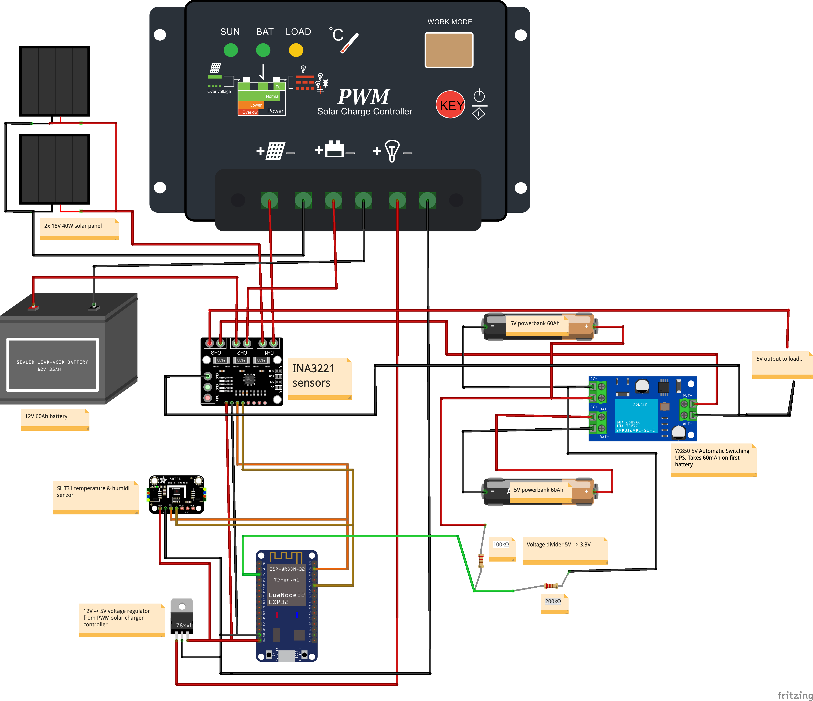

# ESP32 beehive solar controler (WiFi version)
Online solar charger and temperature monitoring based on the ESP32. PWM solar charger charge 12v lead acid battery. YX850 switches two big 5v powerbanks (60Ah) and is measured with INA3221.

## 🚀 BLYNK 2.0 🚀
Project is devepoled using new version of [Blynk 2.0](https://docs.blynk.io/en/)

> To build a project, you need to download all the necessary libraries and create the *settings.cpp* file in the *src* folder:
```c++
// Project settings
#include "IPAddress.h"

struct Settings
{
    const char *wifiSSID = "YYY";
    const char *wifiPassword = "ZZZ";
    const char *blynkAuth = "XXX";
    const char *version = "3.1.0";
    const char *beesysToken = "TTT"; // BLE_GATEWAY_TOKEN z beeSysu (deploy/.env)
};
```

> Build: `pio run -e esp32dev` (platforma pevně espressif32@6.10.0 = Arduino-ESP32 2.0.17), testy parseru BLE: `pio test -e native`.
### Features
* measuring the temperature and humidity
* measuring the solar charger and 12V battery
* measuring powerbanks
* gateway for BLE thermometers Xiaomi LYWSD03MMC with [pvvx firmware](https://github.com/pvvx/ATC_MiThermometer) (formats pvvx custom, ATC1441, BTHome v2): every 5 min a 10 s passive NimBLE scan, then Wi-Fi; data to Blynk V58–V83 and to beeSys. Settings in `src/ble_config.h`, home test in [docs/zkouska-xiaomi.md](docs/zkouska-xiaomi.md)
* OTA safety: after a Blynk.Air update the new firmware must reach Blynk in its first cycle, otherwise the bootloader rolls back to the previous version (`lib/OtaGuard`)

### Currents list:

* ESP32 WROOM-32
* SHT31 temperature & humidity sensor
* INA3221 sensor
* 2x 18V 40W Solar panel
* PWM solar charger 10A
* 12V 60Ah lead acid battery
* YX850 5V Automatic Switching UPS

### Schema:

